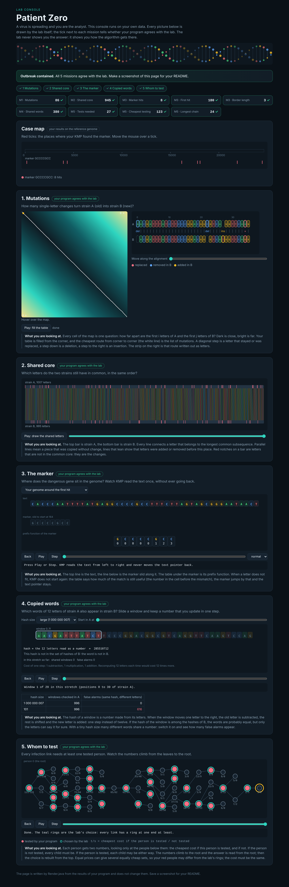

# Assignment 4. Patient Zero

Student ID: 251924
Name:
Group:

This file is the report. Fill it in as you go. How to start: `START_HERE.md`. The task: `docs/Assignment4.pdf`.

## Program output

The 9 lines your program prints on your data (`java -cp out Main`):

    Mutations: 86
    Shared core: 945
    Marker hits: 8
    First hit: 180
    Border length: 3
    Shared words: 380
    Tests needed: 27
    Cheapest testing: 123
    Longest chain: 24

`java tools/Check.java`: tiny, small and dense, all 9 lines are right. The lab console says "Outbreak contained. All 5 missions agree with the lab."

My outbreak report (a screenshot of `output/outbreak.html`):

## Questions

Answer in your own words, two or three sentences each.

**Mission 1. What does the cell d[i][j] of your table mean, and how is it computed from other cells?**

d[i][j] is the smallest number of changes that turn the first i letters of A into the first j letters of B. The first row and column are j and i (insert or delete everything). Every other cell looks at the last step: the diagonal d[i-1][j-1] plus 0 if A[i-1] = B[j-1] or plus 1 for a replacement, the cell above d[i-1][j] plus 1 (delete A[i-1]), or the cell on the left d[i][j-1] plus 1 (insert B[j-1]), and takes the smallest. The answer is the bottom-right corner d[|A|][|B|] = 86.

**Mission 2. How is the longest common subsequence different from the longest common substring? My Shared core is bigger than the number of letters that are the same at the same place: why?**

A substring must be one block of neighbouring letters, a subsequence only has to keep the order, so it may skip letters in both strains. In the table this means: if the letters are equal take the diagonal plus 1, otherwise take the bigger of the top and the left cell (for a substring you would reset to 0 instead). My strains have only 266 equal letters at the same index, but the shared core is 945, because every insertion or deletion shifts the rest of B by one place, so after the first one the same-index comparison only matches by chance (about one letter in four), while the LCS skips the inserted letter and lines the strains up again.

**Mission 3. What does the prefix function tell you, and why does the pointer in the text never go back in KMP? What is the Border length of my marker and what does it mean?**

pi[i] is the length of the longest proper prefix of the marker that is also a suffix of the first i+1 letters. When the next text letter does not match, the last k text letters are exactly the first k letters of the marker, so I already know them: I only move k back to pi[k-1] (the longest border that still fits) and try the same text letter again, and never re-read earlier text letters. My marker is GCCCCGCC with pi = [0, 0, 0, 0, 0, 1, 2, 3], so the Border length is 3: "GCC" is both the start and the end. After a full match KMP continues with k = 3, so a next hit could start already 5 letters later and overlap the previous one by 3 letters (in my genome the 8 hits are far apart and do not overlap).

**Mission 4. Why must you compare the letters after the hashes are equal? What happens to the cost of Rabin-Karp if many windows have the same hash?**

The hash is a number modulo MOD, and there are 4^12 (about 16.7 million) possible 12-letter words, so two different words can get the same number: equal hashes only say "maybe equal". Without the comparison every false alarm would be counted; my code gives 380 with MOD = 1 000 000 007 and also 380 with MOD = 101 (and even with MOD = 1, tested), which shows the letters are really compared. If many windows have the same hash, almost every lookup becomes a letter-by-letter comparison of k letters against many candidates, so the time grows from about O(|A| + |B|) to O(|A| · |B| · k) in the worst case, the same as the naive comparison.

**Mission 5. What are the two states of a person in your DP, and how do you get the answer for a person from its children? Why does a greedy "test the person with most links first" not always give the cheapest answer?**

For every person v (looking only at v and the people below it, the tree rooted in 0): take[v] = the cheapest cost if v is tested, and skip[v] = the cheapest cost if v is not tested. take[v] = cost[v] + sum over children of min(take[c], skip[c]), because the link v-c is already covered; skip[v] = sum over children of take[c], because then every child must be tested. The answer is min(take[0], skip[0]), and I rebuild who is tested from the root down: a person must be tested if the parent is not, otherwise he is tested only if take <= skip. Greedy does not work because it looks at the number of links, not at the price and not at what the choice does further down: in a star whose centre costs 10 and three leaves cost 1 each, greedy tests the centre for 10, but testing the three leaves covers all links for 3.

Longest chain: down[v] is the longest way from v down to a leaf; the longest chain whose highest person is v is the sum of the two longest ways down through two different children, and the answer is the maximum over all people (24 links on my tree of 61 people).

## AI use

The syllabus requires you to say which AI tools you used and for what. Write the tool (ChatGPT, Copilot, other) and what you asked it: explain an idea, find an error, review code. Write "none" if you did not use any. If you took code or text from a book or a website, give the source here.

I used Claude (Anthropic). It wrote the code of the five missions (Strains, Marker, Outbreak), tested it against brute force on random small cases, ran Bench, made the screenshot and drafted the answers in this README. I read the code and the answers, checked them on the examples in `examples/` and in the lab console, and I am ready to explain every line.

## Timing (Mission 7)

Milliseconds, average of 3 runs, from `java -cp out Bench`.

| test | size | time |
|---|---|---|
| naive search | 20 000 / 40 000 / 80 000 | 44.2 / 108.3 / 266.3 |
| KMP | 20 000 / 40 000 / 80 000 | 2.3 / 1.4 / 0.6 |
| edit distance | 500 / 1000 / 2000 / 4000 | 6.7 / 19.0 / 32.9 / 146.8 |

What do the numbers say about how the time grows? When you double the size, by how much does each time grow? Two or three sentences.

The naive search does up to m = 2000 comparisons at every position, so it is O(n · m); with m fixed, doubling the text makes it about 2.4 times slower, and it is already 100 to 400 times slower than KMP. KMP is O(n + m) and should only double, but its times are so small (a few milliseconds) that the JVM warm-up hides the growth: the first run is the slowest because the code is not compiled yet. Edit distance fills an n × n table, O(n²): from 2000 to 4000 letters the time grows about 4.5 times, close to the expected 4 (the small sizes are again blurred by the warm-up).

## Complexity

n is the length of the text (or of a strain), m the length of the pattern, k the length of the window, v the number of people. Fill in every algorithm you wrote.

| algorithm | time | space | assumptions |
|---|---|---|---|
| Edit distance | O(n · m) | O(n · m) | n, m = lengths of A and B; the whole table (n+1) × (m+1) is kept; two rows would be enough for the number alone (O(m) space). |
| LCS | O(n · m) | O(n · m) | Same kind of table, every cell in O(1). |
| Prefix function and KMP | O(n + m) | O(m) + the hits | pi costs O(m), the search O(n): k grows by at most 1 per text letter and every fall back makes it smaller, so all the while-loops together are at most n steps. My hit array is O(n) in the worst case. |
| Rabin-Karp (shared words) | O(n + m) expected, O(n · m · k) worst | O(m) | n, m = lengths of A and B. Every new hash is O(1) (rolling), a hit costs k letter comparisons; few false collisions with MOD = 10^9+7. The worst case is when almost all hashes collide. The map keeps one hash and start for every window of B. |
| Tree DP | O(v) | O(v) | Every person and every link is visited a constant number of times (BFS order from 0, then backwards); the same for the longest chain. |

## Before you submit

- The four files in `data` and the screenshot `output/outbreak.png` are in the repository.
- `java tools/Check.java` shows all examples right.
- This README is filled in, the program output and the section AI use included.
- The work is pushed to main (at least one commit per mission) and the repository is public.
- The link is attached in Moodle.
